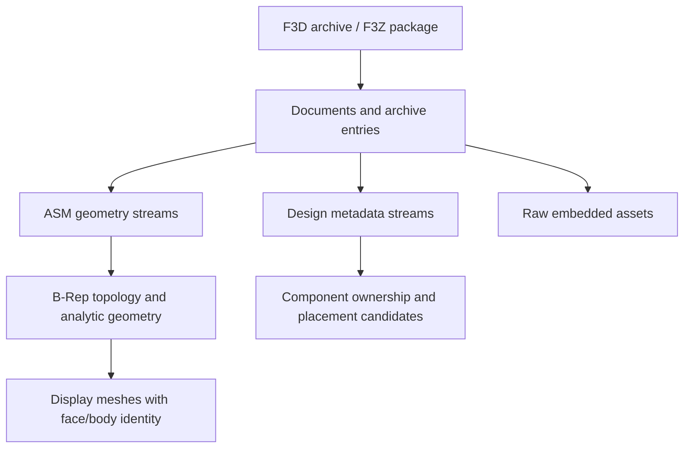

# f3d-rs

**Read Autodesk Fusion files from Rust, without running Fusion.**

f3d-rs opens `.f3d` design archives and `.f3z` packages to inspect their stored
geometry, recover component and placement information, and build display meshes.
It is intended for developers building file inspectors, geometry importers, and
viewers that need access to Fusion data outside Autodesk's applications.

The library runs natively and compiles to WebAssembly. It does not require
Python, an installed copy of Fusion, or an Autodesk service at runtime.
It reads the saved contents of a design; it does not execute its feature timeline
or provide a CAD modeling kernel.

## Origins and relationship to ezf3d

This project adapts portions of [ezf3d](https://github.com/AlexSabaka/ezf3d),
a Python reader for Fusion files. That work provides the basis for the archive
and binary-stream interpretation, ASM geometry layouts and topology traversal,
and parts of the analytic tessellation algorithms.

f3d-rs implements that subset in Rust, with checked binary reads, explicit
resource limits, structured diagnostics, and archive decoding that also works
in browser builds. It preserves source records when higher-level geometry or
metadata interpretation is unsupported. It does not embed or call Python, and
it is **not a complete port of ezf3d**.

The Python implementation is also used for optional development comparisons of
decoded tokens, geometry evaluations, and meshes. The reference revision and
adapted areas are recorded in [THIRD-PARTY-NOTICES](THIRD-PARTY-NOTICES).
The upstream MIT notice is retained in [LICENSE-MIT-ezf3d](LICENSE-MIT-ezf3d).
This is an independent project, not an Autodesk-supported SDK.

## How it works

A Fusion file contains more than a mesh. The reader opens the archive, separates
its documents and data streams, and exposes geometry alongside the information
needed to identify its components.



B-Rep (boundary representation) describes a solid through its bodies, faces,
edges, and vertices. f3d-rs exposes those records for inspection and can
approximate supported faces with triangles. Assembly metadata is returned
separately: the reader does not silently choose placements or flatten external
references into a single assembly.

## Capabilities and limitations

| Area | Current support |
|---|---|
| Archives | Stored, Deflate, and Zstandard ZIP entries; CRC verification; nested F3D/F3Z packages with resource limits |
| Geometry records | ASM/ACIS binary tokens, live topology traversal, and retained source records |
| Analytic geometry | Lines, ellipses, planes, cones/cylinders, spheres, and tori |
| Display meshes | Supported trimmed analytic faces, planar holes, and periodic bands; per-face/body identity and skipped-face diagnostics |
| Assembly information | Component names, supported ownership bindings, and rigid placement candidates; occurrence decoding is partial |
| Embedded assets | Raw decompressed previews, materials, CAM XML, and other archive payloads |
| Splines | Tokens retained; typed NURBS extraction, evaluation, and tessellation are not implemented |

The library does not write Fusion files, regenerate features, solve sketches,
perform solid-modeling operations, decode graphics caches, or export standard
mesh-file formats. A successful read does not guarantee a complete display mesh
or a watertight solid. Compatibility is limited to the record layouts currently
implemented; unsupported metadata and skipped faces remain visible in diagnostics.

See [reading notes](docs/reading-notes.md) for detailed format coverage.

## Quick start

Requires Rust **1.88 or newer**. Add the library as a Git dependency:

```toml
[dependencies]
f3d = { package = "f3d-rs", git = "https://github.com/neofactory/f3d-rs" }
```

Open a file and inspect its documents, geometry counts, and diagnostics:

```rust,no_run
use f3d::FusionFile;

fn main() -> f3d::Result<()> {
    let file = FusionFile::open("model.f3d")?;

    for document in file.documents() {
        println!("{:#?}", document.summary());
        for brep in &document.breps {
            println!("{}: {:?}", brep.path, brep.model.census());
        }
        for issue in &document.issues {
            eprintln!("{} [{}]: {}", issue.path, issue.stage, issue.message);
        }
    }
    Ok(())
}
```

For in-memory input, `FusionFile::read` accepts a `Read + Seek` source and
explicit `Limits`. `FusionFile::open_with_limits` accepts limits for a file on disk.

From a checkout, the examples can inspect a file or produce JSON for another tool:

```sh
cargo run --example inspect -- /path/to/model.f3d
cargo run --example inspect -- /path/to/model.f3d --summary-json
cargo run --example inspect -- /path/to/model.f3d --json > decoded.json
cargo run --release --example mesh -- /path/to/model.f3d --json > mesh.json
```

## Understanding the output

**Documents and assets.** F3Z members remain separate documents. Each document
exposes its B-Rep streams, recovered assembly information, diagnostics, and
archive entries. `document.archive.bytes(entry_name)` returns an entry's exact
decompressed payload, including formats the library does not interpret.

**Units and placement.** Geometry stays in native source units; Fusion normally
uses centimetres. Placement candidates carry an explicit `cm` label. Meshes do
not automatically include occurrence placements. Use `Document::brep_owners`
and the owner's `placement_candidates()` to inspect the relationship before
applying a verified transform. Multiple candidates remain explicit ambiguity.

**Display meshes.** Tessellation returns vertex positions, triangle indices,
source face/body identities, and coverage diagnostics:

```rust,no_run
use f3d::{FusionFile, mesh};

fn main() -> f3d::Result<()> {
    let file = FusionFile::open("model.f3d")?;
    for document in file.documents() {
        for brep in &document.breps {
            let report = mesh::tessellate(&brep.model, &Default::default())?;
            println!("{} triangles, {} skipped faces",
                report.triangles.len(), report.faces_skipped);
            for issue in &report.issues {
                eprintln!("{:?}: {}", issue.kind, issue.reason);
            }
            for body in report.split_by_body()? {
                println!("body {}: {} triangles",
                    body.body_index, body.triangles.len());
            }
        }
    }
    Ok(())
}
```

`MeshOptions` controls tolerance and sampling/output budgets. Unsupported faces
are skipped with reasons, so applications should show coverage alongside the
result. Inspect `Document::issues` for metadata limitations and mesh issues for
missing faces. Typed errors distinguish unsupported geometry from malformed
geometry. [Reading notes](docs/reading-notes.md) explain transforms, units,
error categories, and mesh limitations in more detail.

## Development and validation

The Rust tests construct synthetic archives and geometry records. They exercise
binary parsing, malformed input, topology, compression, resource limits, and
mesh generation without requiring a private CAD model.

```sh
cargo test --locked --all-targets
cargo test --locked --doc
```

Optional Python tools compare the Rust output against ezf3d using a model you
supply. See [development and validation](docs/validation.md) for environment
setup, checks, and the scope of previously recorded private-model results.

## License and attribution

[MIT](LICENSE). Retain [LICENSE](LICENSE),
[LICENSE-MIT-ezf3d](LICENSE-MIT-ezf3d), and
[THIRD-PARTY-NOTICES](THIRD-PARTY-NOTICES) when distributing adaptations.
Input CAD models retain their own licensing; the software license does not
grant rights to those files.
